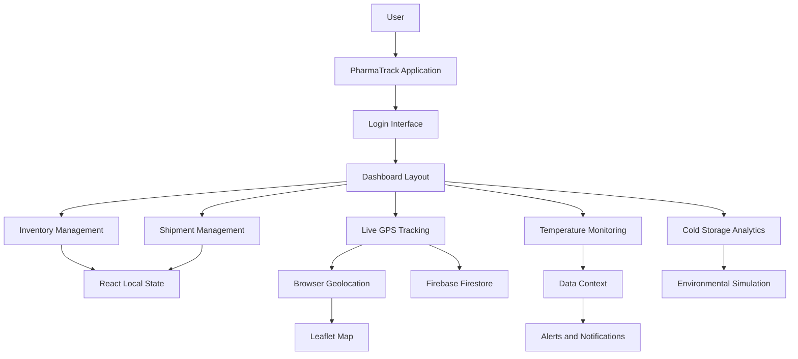

# 💊 NEXVIX PharmaTrack

<p align="center">
  <strong>Smart Pharmaceutical Logistics & Monitoring Platform</strong>
</p>

<p align="center">
  Intelligent inventory management, GPS shipment tracking, cold-chain monitoring and pharmaceutical preservation analytics.
</p>

<p align="center">
  
  
  
  
  
</p>

---

## 📌 Table of Contents

1. [Introduction](#-introduction)
2. [Project Overview](#-project-overview)
3. [Project Objectives](#-project-objectives)
4. [Key Features](#-key-features)
5. [Technology Stack](#-technology-stack)
6. [System Architecture](#-system-architecture)
7. [Project Structure](#-project-structure)
8. [Application Modules](#-application-modules)
9. [Inventory Management](#-inventory-management)
10. [Shipment Management](#-shipment-management)
11. [Live GPS Tracking](#-live-gps-tracking)
12. [Temperature Monitoring](#-temperature-monitoring)
13. [Cold Storage and Preservation](#-cold-storage-and-preservation)
14. [Alerts and Notifications](#-alerts-and-notifications)
15. [Firebase Integration](#-firebase-integration)
16. [Installation and Setup](#-installation-and-setup)
17. [Environment Configuration](#-environment-configuration)
18. [Running the Application](#-running-the-application)
19. [Production Build](#-production-build)
20. [Deployment](#-deployment)
21. [Security Considerations](#-security-considerations)
22. [Current Implementation Status](#-current-implementation-status)
23. [Future Enhancements](#-future-enhancements)
24. [Contributing](#-contributing)
25. [License](#-license)
26. [Repository](#-repository)

---

## 💊 Introduction

**NEXVIX PharmaTrack** is a smart pharmaceutical logistics and monitoring platform designed to improve the visibility, management and monitoring of pharmaceutical products throughout storage and transportation.

Pharmaceutical products such as vaccines, insulin, antibiotics and other temperature-sensitive medicines require appropriate storage and transportation conditions to maintain their quality and effectiveness.

Traditional pharmaceutical logistics operations can face challenges such as:

- Difficulty monitoring medicine storage conditions.
- Limited visibility into transportation activities.
- Temperature fluctuations during transportation.
- Medicine expiry and stock-management issues.
- Delayed deliveries.
- Lack of centralized monitoring.
- Difficulty identifying critical environmental conditions.

NEXVIX PharmaTrack aims to address these challenges through an integrated digital monitoring dashboard.

The platform combines pharmaceutical inventory management, shipment monitoring, GPS tracking, temperature monitoring and cold-storage analytics into a unified interface.

The long-term vision is to integrate IoT sensors and connected monitoring devices to support real-time pharmaceutical logistics management.

---

## 🚀 Project Overview

NEXVIX PharmaTrack is designed around five major operational areas:

1. Pharmaceutical Inventory Management
2. Shipment and Transportation Management
3. Live GPS Tracking
4. Temperature and Cold-Chain Monitoring
5. Cold Storage and Preservation Analytics

The application provides a centralized dashboard that displays operational indicators, monitoring information, shipment conditions and environmental alerts.

### Project Vision

To develop an intelligent pharmaceutical logistics ecosystem that improves medicine traceability, storage monitoring, transportation visibility and pharmaceutical supply-chain reliability.

### Target Users

- Pharmaceutical manufacturers.
- Medicine distributors.
- Pharmaceutical warehouses.
- Hospitals and healthcare organizations.
- Cold-chain logistics providers.
- Pharmacy supply-chain operators.
- Pharmaceutical transportation teams.

---

## 🎯 Project Objectives

- Develop a centralized pharmaceutical logistics dashboard.
- Maintain medicine inventory and batch information.
- Monitor medicine quantities and expiry dates.
- Track pharmaceutical shipments.
- Visualize vehicle location using GPS.
- Monitor temperature conditions during storage and transportation.
- Identify temperature warnings and critical conditions.
- Maintain environmental monitoring information.
- Integrate Firebase for cloud-based location storage.
- Provide a foundation for future IoT sensor integration.
- Improve pharmaceutical supply-chain visibility.

---

## ✨ Key Features

### 1. Interactive Dashboard

The dashboard provides a consolidated view of pharmaceutical logistics operations.

Key indicators include:

- Active Shipments.
- Medicines in Transit.
- Inventory Health.
- Low Stock Alerts.
- Temperature Warnings.
- Delayed Deliveries.

The dashboard uses visual status indicators and monitoring cards to make operational information easier to understand.

### 2. Pharmaceutical Inventory Management

The inventory module provides medicine record management.

Features include:

- Add new medicine records.
- Edit existing medicine information.
- Delete medicine records.
- Search by medicine name.
- Search by batch ID.
- Search by shipment ID.
- Filter by inventory status.
- Monitor stock quantities.
- View expiry dates.
- Maintain manufacturer information.
- Associate medicines with shipment IDs.
- Define medicine storage temperature ranges.

### 3. Shipment Management

The shipment module displays pharmaceutical transportation information.

Features include:

- Shipment identification.
- Driver information.
- Vehicle identification.
- Destination details.
- Expected delivery time.
- Shipment status.
- Medicine quantities.
- Transportation condition.
- Search and status filtering.

Supported shipment statuses:

- In Transit.
- Delivered.
- Delayed.
- Loading.

### 4. Live GPS Tracking

The GPS tracking module uses browser geolocation to obtain location coordinates.

Features include:

- Current latitude and longitude.
- Vehicle movement status.
- Speed monitoring.
- Interactive map visualization.
- Current vehicle location marker.
- Historical route path visualization.
- Automatic map repositioning.
- Firebase Firestore location storage.

### 5. Temperature Monitoring

The temperature monitoring module provides visibility into pharmaceutical storage conditions.

Features include:

- Multiple temperature monitoring units.
- Current temperature readings.
- Minimum safe temperature.
- Maximum safe temperature.
- Optimal, warning and critical status indicators.
- Temperature trend information.
- Temperature aggregation visualization.
- Automated simulated temperature updates.
- Temperature-related notifications.

### 6. Cold Storage and Preservation Analytics

The cold-storage module provides environmental monitoring indicators.

Features include:

- Cold-storage network status.
- Ambient humidity.
- Drug preservation indicator.
- Shipment safety score.
- Storage health analytics.
- Dynamic environmental simulation.
- Future IoT integration support.

### 7. Alert and Notification System

The application provides notification indicators for monitoring events.

Examples include:

- Temperature fluctuations.
- Critical temperature conditions.
- Warning conditions.
- Shipment-related alerts.
- Unauthorized door-opening events in the sample dashboard.
- Delivery confirmation notifications.

Notifications are displayed temporarily and automatically removed after five seconds.

---

## 🛠️ Technology Stack

### Frontend

| Technology | Purpose |
|---|---|
| React 18 | Component-based UI development |
| JavaScript ES Modules | Application logic |
| HTML5 | Application structure |
| Tailwind CSS 4 | Responsive styling |
| Lucide React | Icons and visual indicators |
| Outfit Font | Typography |

### Development and Build Tools

| Technology | Purpose |
|---|---|
| Vite 7 | Development server and bundler |
| Node.js | JavaScript runtime |
| npm | Package management |

### Cloud and Mapping

| Technology | Purpose |
|---|---|
| Firebase | Cloud platform |
| Cloud Firestore | GPS location storage |
| Leaflet | Interactive mapping |
| React Leaflet | React map integration |
| OpenStreetMap | Geographic data |
| CARTO | Dark map tile visualization |

---

## 🏗️ System Architecture

The application follows a component-based React architecture with centralized state management and Firebase integration.

### High-Level Architecture



### Architecture Components

**Presentation Layer**

React components provide the dashboard, inventory interface, shipment information, monitoring cards and interactive maps.

**Application Layer**

React state and Context API manage inventory, shipment, temperature and notification information.

**Mapping Layer**

Leaflet and React Leaflet provide map visualization, vehicle markers and route paths.

**Cloud Integration Layer**

Firebase Cloud Firestore stores GPS location records generated by the tracking module.

**Future IoT Layer**

The architecture is intended to support physical temperature, humidity and other environmental monitoring sensors.

---

## 📁 Project Structure

```text
NEXVIX-PharmaTrack/
│
├── public/
│   └── Public static assets
│
├── src/
│   │
│   ├── components/
│   │   ├── Layout.jsx
│   │   ├── Sidebar.jsx
│   │   ├── LoginPage.jsx
│   │   ├── DashboardPanel.jsx
│   │   ├── InventoryPage.jsx
│   │   ├── ShipmentsPage.jsx
│   │   ├── LiveTrackingPage.jsx
│   │   ├── TemperaturePage.jsx
│   │   ├── ColdStoragePage.jsx
│   │   └── NotificationToast.jsx
│   │
│   ├── context/
│   │   └── DataContext.jsx
│   │
│   ├── firebase.js
│   ├── App.jsx
│   ├── main.jsx
│   └── index.css
│
├── .gitignore
├── index.html
├── package.json
├── package-lock.json
├── vite.config.js
│
└── README.md
```

### Important Files

| File | Responsibility |
|---|---|
| `main.jsx` | React application entry point |
| `App.jsx` | Main application and login-state handling |
| `Layout.jsx` | Dashboard navigation and module rendering |
| `DataContext.jsx` | Centralized monitoring state and simulation |
| `InventoryPage.jsx` | Medicine inventory management |
| `ShipmentsPage.jsx` | Shipment information and filtering |
| `LiveTrackingPage.jsx` | GPS tracking and map visualization |
| `TemperaturePage.jsx` | Temperature monitoring |
| `ColdStoragePage.jsx` | Environmental and preservation analytics |
| `firebase.js` | Firebase initialization and Firestore connection |
| `index.css` | Global styles and Tailwind configuration |
| `vite.config.js` | Vite and React configuration |
| `package.json` | Dependencies and development scripts |

---

## 📦 Inventory Management

The inventory module maintains pharmaceutical product information.

### Medicine Information

Each inventory record can contain:

- Medicine name.
- Batch ID.
- Shipment ID.
- Quantity.
- Expiry date.
- Manufacturer.
- Storage temperature range.
- Inventory status.
- Price.
- Medicine type.

### Inventory Status Categories

| Status | Description |
|---|---|
| In Stock | Medicine is available |
| Low Stock | Medicine quantity requires attention |
| Quarantined | Medicine is isolated from normal stock |
| Expired | Medicine has passed its expiry date |

### Inventory Operations

The module supports CRUD-style operations:

- Create medicine records.
- Read and search records.
- Update medicine information.
- Delete records.

Inventory records are currently managed through React component state. Persistent database storage is a planned enhancement.

---

## 🚚 Shipment Management

The shipment module provides a structured view of pharmaceutical transportation.

### Shipment Information

Each shipment record can contain:

- Shipment ID.
- Driver name.
- Vehicle registration or identifier.
- Destination.
- Shipment status.
- Expected delivery time.
- Transportation condition.
- Medicine quantity.

### Shipment Status

| Status | Description |
|---|---|
| Loading | Shipment is being prepared |
| In Transit | Shipment is being transported |
| Delivered | Shipment has reached its destination |
| Delayed | Shipment is behind schedule |

### Shipment Search

Users can search shipment information using:

- Shipment ID.
- Destination.
- Driver name.

Status filtering is also available.

---

## 📍 Live GPS Tracking

The live tracking module provides an interactive geographical visualization of location information.

### GPS Functionality

The module uses the browser Geolocation API.

It collects:

- Latitude.
- Longitude.
- Speed.
- Movement status.
- Location timestamp.

### Map Visualization

Leaflet and React Leaflet provide the interactive map interface.

Map functionality includes:

- Vehicle location marker.
- Current map position.
- Automatic map repositioning.
- Historical route path.
- Vehicle information popup.
- Dark map visualization.

### Movement Detection

The application determines vehicle movement based on the reported speed.

- Speed greater than zero: Moving.
- Speed equal to zero: Stationary.

### Location Storage

The application periodically writes the latest location information to the Firestore collection:

`vehicle_locations`

The location record contains:

```json
{
  "latitude": 42.3601,
  "longitude": -71.0589,
  "speed": 0,
  "status": "Stationary",
  "timestamp": "2026-11-03T00:00:00.000Z"
}
```

The above values are illustrative examples of the data structure.

The current implementation records the browser's location. Connecting a dedicated GPS device installed in a delivery vehicle is a future integration.

---

## 🌡️ Temperature Monitoring

Temperature monitoring is an important part of pharmaceutical cold-chain management.

The application provides monitoring units for different pharmaceutical storage environments.

### Monitoring Categories

| Category | Example Safe Range |
|---|---|
| Ultra-Cold | -80°C to -60°C |
| Cold Chain | 2°C to 8°C |
| Ambient | 15°C to 25°C |
| Frozen | -25°C to -15°C |

These are example ranges configured in the demonstration data and should not be treated as universal storage instructions for every medicine.

### Monitoring Parameters

Each monitoring unit maintains:

- Monitoring ID.
- Storage or shipment name.
- Monitoring type.
- Current temperature.
- Minimum safe temperature.
- Maximum safe temperature.
- Monitoring status.
- Temperature trend.

### Temperature Status Logic

**Optimal**

Temperature remains within the defined safe range and outside the warning margin.

**Warning**

Temperature approaches the upper or lower safe limit.

**Critical**

Temperature reaches or exceeds the configured safe limits.

### Temperature Simulation

The current application updates simulated temperature values every three seconds.

The simulation:

1. Generates a small temperature variation.
2. Adjusts the variation based on the monitoring trend.
3. Calculates the new temperature status.
4. Detects warning and critical transitions.
5. Generates notifications when conditions worsen.
6. Updates the related shipment condition when a linked monitoring unit changes to a warning or critical state.

Physical sensor integration is planned for a future version.

---

## ❄️ Cold Storage and Preservation

The cold-storage module presents environmental and preservation indicators for pharmaceutical storage environments.

### Main Monitoring Indicators

**1. Cold Storage Network**

Displays the cold-storage network status.

**2. Ambient Humidity**

Displays simulated environmental humidity values.

**3. Drug Preservation Indicator**

Displays a simulated preservation percentage.

**4. Shipment Safety Score**

Displays a simulated safety score out of 100.

### Environmental Simulation

The prototype updates the following indicators every three seconds:

- Humidity.
- Preservation percentage.
- Safety score.

These values are demonstration indicators and are not calculated from validated medicine-quality measurements.

### Future Integration

The module is intended to support:

- Temperature sensors.
- Humidity sensors.
- IoT monitoring nodes.
- Cold-storage equipment telemetry.
- Environmental alert systems.

---

## 🔔 Alerts and Notifications

The application uses a centralized notification mechanism in `DataContext.jsx`.

### Notification Types

- Success.
- Warning.
- Critical.

### Notification Workflow

```text
Monitoring Data Changes
        |
        v
Check Temperature Limits
        |
        v
Determine Monitoring Status
        |
        v
Detect Status Transition
        |
        v
Generate Alert
        |
        v
Display Notification
        |
        v
Automatically Remove After 5 Seconds
```

The system also maintains a limited list of recent temperature alerts.

---

## 🔥 Firebase Integration

Firebase is used for cloud-based location storage.

### Current Firebase Service

**Cloud Firestore**

The application initializes Firebase using environment-based configuration and obtains a Firestore database reference.

### Firestore Collection

Collection name:

`vehicle_locations`

### Stored Information

| Field | Data Type | Description |
|---|---|---|
| latitude | Number | GPS latitude |
| longitude | Number | GPS longitude |
| speed | Number | Reported speed in metres per second |
| status | String | Moving or Stationary |
| timestamp | String | Location timestamp |

### Firebase Configuration

Firebase credentials are read using Vite environment variables.

The Firebase configuration is initialized in:

`src/firebase.js`

Firebase Authentication is not currently connected to the login workflow. The existing login screen is a frontend demonstration interface.

---

## 💻 Installation and Setup

### Prerequisites

Install the following software:

- Node.js (compatible with the installed Vite version).
- npm.
- Visual Studio Code.
- Git.
- Modern web browser.
- Firebase account.

### Step 1: Clone the Repository

```bash
git clone https://github.com/gandha-24/NEXVIX-PharmaTrack.git
```

### Step 2: Navigate to the Project

```bash
cd NEXVIX-PharmaTrack
```

### Step 3: Open in Visual Studio Code

```bash
code .
```

### Step 4: Install Dependencies

```bash
npm install
```

### Step 5: Configure Firebase

Create a Firebase project and enable Cloud Firestore.

Configure the required Firebase environment variables.

### Step 6: Start the Development Server

```bash
npm run dev
```

### Step 7: Open the Application

Vite will display a local development URL in the terminal.

Usually:

```text
http://localhost:5173
```

Open the displayed URL in your browser.

---

## 🔐 Environment Configuration

Create a `.env` file in the project root.

Add the following Firebase configuration:

```env
VITE_FIREBASE_API_KEY=your_firebase_api_key

VITE_FIREBASE_AUTH_DOMAIN=your_project.firebaseapp.com

VITE_FIREBASE_PROJECT_ID=your_project_id

VITE_FIREBASE_STORAGE_BUCKET=your_project.firebasestorage.app

VITE_FIREBASE_MESSAGING_SENDER_ID=your_sender_id

VITE_FIREBASE_APP_ID=your_app_id
```

Replace the example values with the actual Firebase project configuration.

### Important Notes

- Never commit private credentials or service-account keys.
- Add `.env` to `.gitignore`.
- Configure Firestore security rules.
- Restrict database access to authorized users.
- Use appropriate Firebase authentication before enabling production access.

The Firebase web configuration is not a substitute for database security rules.

---

## ▶️ Running the Application

### Development Mode

```bash
npm run dev
```

Starts the Vite development server.

### Production Build

```bash
npm run build
```

Creates the optimized production build.

### Preview Production Build

```bash
npm run preview
```

Starts a local server to preview the production build.

---

## 🚀 Deployment

The application can be deployed using static hosting services that support Vite production builds.

Suitable deployment platforms include:

- Firebase Hosting.
- Cloudflare Pages.
- Vercel.
- Netlify.

### Deployment Steps

1. Build the application.

```bash
npm run build
```

2. The production files are generated in the `dist/` directory.

3. Select a hosting platform.

4. Configure the environment variables.

5. Set the build command:

```bash
npm run build
```

6. Set the output directory:

```text
dist
```

7. Deploy the application.

8. Verify Firebase connectivity and browser location permissions.

### GPS Requirements

Browser geolocation generally requires a secure HTTPS context, except for localhost development.

Users must grant location permission for tracking functionality to work.

---

## 🔒 Security Considerations

Pharmaceutical logistics platforms handle operational information and potentially sensitive location data.

Recommended security practices:

1. Implement Firebase Authentication.
2. Use role-based access control.
3. Configure restrictive Firestore security rules.
4. Validate all stored information.
5. Protect vehicle location information.
6. Obtain user consent before collecting location data.
7. Avoid exposing sensitive information in frontend code.
8. Implement appropriate database access restrictions.
9. Use HTTPS for production deployment.
10. Maintain audit logs for important operations.
11. Implement server-side validation for critical monitoring data.
12. Use validated physical sensors before relying on temperature readings for pharmaceutical safety decisions.

---

## 📊 Current Implementation Status

The current repository represents an interactive prototype.

| Module | Current implementation |
|---|---|
| Dashboard | Interactive demonstration |
| Login | Frontend-only login state |
| Inventory | Local React state |
| Shipments | Sample records |
| GPS Tracking | Browser geolocation and Firestore writes |
| Map Visualization | Leaflet and React Leaflet |
| Temperature Monitoring | Simulated telemetry |
| Alerts | React Context notification system |
| Cold Storage | Simulated environmental indicators |
| Physical IoT Sensors | Planned |
| Firebase Authentication | Not implemented |
| Persistent Inventory Database | Planned |
| Real Vehicle GPS Hardware | Planned |

This distinction is important when evaluating the application for real-world pharmaceutical deployment.

---

## 🔮 Future Enhancements

The following improvements can help evolve NEXVIX PharmaTrack into a more comprehensive pharmaceutical logistics platform.

### 1. IoT Sensor Integration

- ESP32-based monitoring nodes.
- DS18B20 temperature sensors.
- DHT22 temperature and humidity sensors.
- GPS modules.
- Door-open detection sensors.
- Real-time sensor communication.

### 2. Advanced Cold-Chain Monitoring

- Continuous temperature monitoring.
- Historical temperature reports.
- Automatic temperature violation alerts.
- Sensor calibration.
- Temperature excursion records.
- Storage condition reports.

### 3. Advanced GPS Tracking

- Dedicated vehicle GPS hardware.
- Multiple vehicle tracking.
- Shipment-specific GPS association.
- Route history storage.
- Geofencing.
- Estimated arrival calculations.

### 4. Advanced Inventory Management

- Persistent cloud database.
- Batch-wise inventory tracking.
- Automatic expiry alerts.
- Low-stock notifications.
- Medicine barcode and QR scanning.
- Stock movement history.
- FIFO and FEFO inventory management.

### 5. User Authentication

- Firebase Authentication.
- Administrator accounts.
- Warehouse operator accounts.
- Logistics manager accounts.
- Role-based permissions.
- Secure session management.

### 6. Analytics and Reporting

- Daily and monthly reports.
- Shipment performance analytics.
- Temperature compliance reports.
- Inventory turnover reports.
- Expiry analysis.
- Downloadable PDF and Excel reports.

### 7. Intelligent Monitoring

- Predictive temperature alerts.
- Shipment delay prediction.
- Inventory demand forecasting.
- Abnormal environmental condition detection.
- Automated operational notifications.

---

## 🤝 Contributing

Contributions, suggestions and improvements are welcome.

### Contribution Guidelines

1. Fork the repository.
2. Create a feature branch.
3. Implement your changes.
4. Test the application.
5. Commit your changes.
6. Push your branch.
7. Create a Pull Request.

Example:

```bash
git checkout -b feature/new-feature

git add .

git commit -m "Add new feature"

git push origin feature/new-feature
```

---

## 📄 License

No LICENSE file was identified in the repository during documentation review.

Please confirm the project's licensing terms with the repository owner before redistributing or reusing the source code.

---

## 🔗 Repository

**Project Name:** NEXVIX PharmaTrack

**Organization:** NEXVIX Innovations

**Repository:**

https://github.com/gandha-24/NEXVIX-PharmaTrack

**Default Branch:** `main`

**Project Category:** Pharmaceutical Logistics and Monitoring

---

<p align="center">
  <strong>NEXVIX PharmaTrack</strong>
  <br/>
  Smarter Pharmaceutical Logistics. Safer Medicine Transportation.
  <br/><br/>
  Developed under NEXVIX Innovations.
</p>
